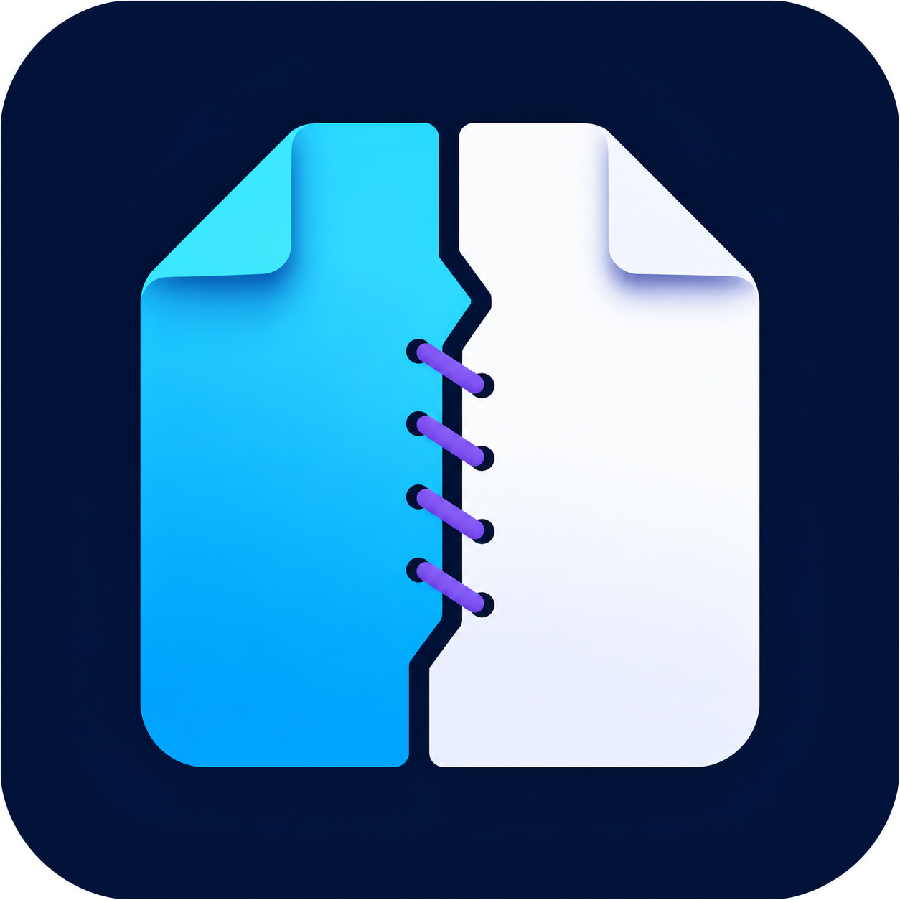

<div align="center">
  
  <h1>Document Tailor</h1>
  <p>離線優先的 Windows 文件 OCR、格式轉換、郵件整理與 PDF 工具。</p>
</div>

## 特色

- 將 Word、PDF、圖片、Outlook MSG、CSV、Excel 與文字檔轉換為 Markdown。
- 掃描 PDF 與 PNG、JPEG、BMP、TIFF 圖片使用 Windows 離線 OCR 辨識；含文字層的 PDF 只對無文字頁執行 OCR。
- 一次選取多份不同格式的文件，以拖曳或按鈕調整順序，再彙整成單一 Markdown。
- 多份 Outlook MSG 可依主旨建立章節，保留郵件中繼資料、附件清單與長討論串正文，並在每段郵件尾端保守排除有明確聯絡資訊的簽名及中英文免責聲明。
- Classic Outlook 可將一封或多封郵件直接拖入工具，不需先手動另存 `.msg`。
- Markdown 可再次輸出成響應式離線 HTML、可編輯 DOCX 或適合定稿列印的 PDF。
- 多份 PDF 也能直接合併成一份 PDF。
- 支援拖放匯入、清單排序、進度提示、取消作業及 Markdown 預覽／編輯。
- 所有文件均在本機處理，不會上傳至雲端。
- 科技感深色介面、首頁動畫與響應式視窗配置。

## 支援格式

| 輸入格式 | 副檔名 | 輸出／用途 |
|---|---|---|
| Microsoft Word | `.docx` | Markdown |
| PDF | `.pdf` | Markdown、PDF 合併 |
| 掃描圖片 | `.png`, `.jpg`, `.jpeg`, `.bmp`, `.tif`, `.tiff` | OCR 後輸出 Markdown |
| Outlook 郵件 | `.msg` | Markdown、郵件彙整 |
| CSV | `.csv` | Markdown 表格 |
| Microsoft Excel | `.xlsx`, `.xlsm` | Markdown 表格 |
| 純文字／Markdown | `.txt`, `.md` | Markdown、文件彙整 |

Markdown 再輸出支援 `.html`、`.docx` 與 `.pdf`。

## 使用方式

### 文件轉 Markdown

1. 開啟「文件轉 Markdown」。
2. 拖放文件，或按下「加入文件」多選匯入。
3. 直接拖曳清單項目，或使用上移、下移按鈕調整章節順序。
4. 按下「轉換並儲存」。
5. 選擇輸出的 `.md` 路徑。

多選 `.msg` 時，每封郵件會以主旨建立獨立章節，再彙整成同一份 Markdown。轉換器會先依 Outlook 郵件標頭與常見引用分隔線切分長討論串，保留各段正文與寄件上下文，再分別處理該段尾端的簽名、行動裝置簽名與免責聲明。內容正確性優先，因此證據不足的疑似簽名會保留，不會冒險截斷正文。

使用 Classic Outlook 時，也可以在郵件清單中選取一封或多封郵件，直接拖到「文件轉 Markdown」的匯入區。工具會將 Outlook 提供的虛擬信件複製到該程式執行個體專用的暫存目錄，程式關閉後自動清除，因此多人從網路磁碟同時執行時不會共用暫存信件。

### 掃描 PDF／圖片 OCR

1. 在「文件轉 Markdown」加入掃描 PDF 或圖片。
2. 如果 PDF 頁面已有文字層，會直接解析；只有沒有文字的頁面才會執行 OCR。
3. 圖片會直接執行 OCR，並在輸出的 Markdown front matter 標記 `ocr: true`。

OCR 使用 Windows 已安裝的辨識語言，不需上傳檔案。繁體中文文件建議安裝 Windows 的「繁體中文」語言功能。

### Markdown 再輸出

1. 開啟「Markdown 再輸出」。
2. 貼上 Markdown，或按下「開啟 Markdown」載入 `.md`。
3. 可直接在編輯區微調內容。
4. 選擇輸出 HTML、DOCX 或 PDF。

HTML 會產生可離線開啟、適合列印的單一檔案；DOCX 使用商務文件樣式與 Word 原生清單／表格；PDF 會嵌入本機 CJK 字型以維持繁體中文可讀性。

### PDF 合併

1. 開啟「PDF 合併」並加入至少兩份 PDF。
2. 拖曳清單項目，或使用上移、下移調整頁面合併順序。
3. 按下「合併並輸出 PDF」。

## 系統需求

- Windows 10 版本 2004（組建 19041）或更新版本、Windows 11，64 位元。
- 若使用 Release 中的 self-contained 單檔版本，不需要另外安裝 .NET Runtime。
- OCR 需要至少一個 Windows OCR 語言；可在「設定 > 時間與語言 > 語言與地區」安裝。
- PDF 中文輸出需要 Windows 內建「微軟正黑體」、Noto Sans TC 或其他支援的中文字型。
- 從原始碼建置需要 [.NET SDK 9](https://dotnet.microsoft.com/download/dotnet/9.0)。

## 從原始碼建置

```powershell
dotnet restore .\src\DocumentTailor\DocumentTailor.csproj
dotnet build .\src\DocumentTailor\DocumentTailor.csproj -c Release
```

## 發佈單檔 EXE

```powershell
dotnet publish .\src\DocumentTailor\DocumentTailor.csproj `
  -c Release `
  -r win-x64 `
  --self-contained true `
  -o .\publish\win-x64
```

輸出檔案為 `publish\win-x64\DocumentTailor.exe`。

## 執行煙霧測試

測試會建立實際的 OCR 圖片、掃描 PDF、DOCX、MSG、CSV 與 Excel 樣本，並模擬 Outlook 多選虛擬檔案拖放，驗證 OCR、郵件長尾清理、格式轉換、Markdown 三種再輸出、多文件彙整及 PDF 合併頁數。

```powershell
dotnet run --project .\tests\DocumentTailor.SmokeTests\DocumentTailor.SmokeTests.csproj -c Release
```

## 專案結構

```text
DocumentTailor/
├─ src/DocumentTailor/                 WPF 桌面應用程式
│  ├─ Models/                          顯示模型
│  ├─ Services/                        文件解析與轉換服務
│  └─ Assets/                          正式應用程式圖示
├─ tests/DocumentTailor.SmokeTests/    端對端煙霧測試
└─ tools/                              圖示建置工具
```

## 已知限制

- Excel 支援 `.xlsx` 與 `.xlsm`，暫不支援舊式 `.xls`。
- MSG 附件會列出檔名，但不會自動解壓或另存附件；郵件長尾清理採內容優先的保守規則，特殊或只有姓名的簡短簽名可能保留，以避免誤刪討論正文。
- Outlook 直接拖曳使用 Windows `FileGroupDescriptorW`／`FileContents` 虛擬檔案格式，支援 Classic Outlook；新版 Outlook 若未提供這些格式，請先另存為 `.msg` 再匯入。
- OCR 品質受掃描解析度、傾斜、背景雜訊與 Windows 已安裝語言影響。
- PDF 的複雜多欄版面、手寫內容或圖片式表格，可能需要人工調整 Markdown。

## 隱私

Document Tailor 不需要帳號，也不會將文件內容傳送至網路。所有解析、轉換與合併均在本機完成。

## 開發者

開發者：[@Louis](https://github.com/LouisWu9966)
